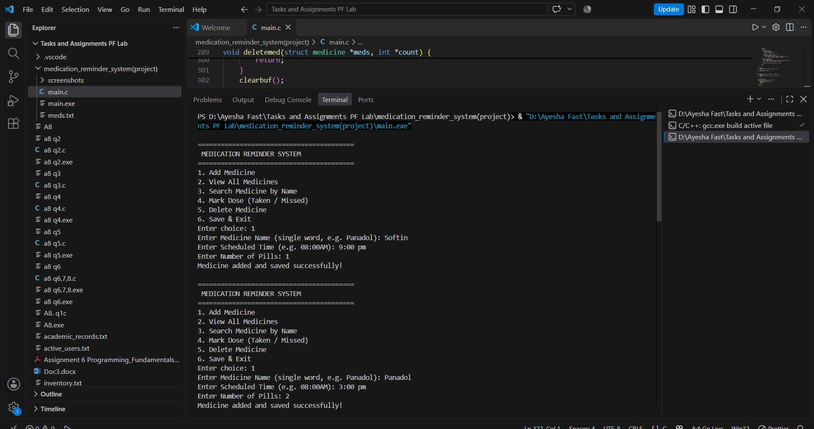
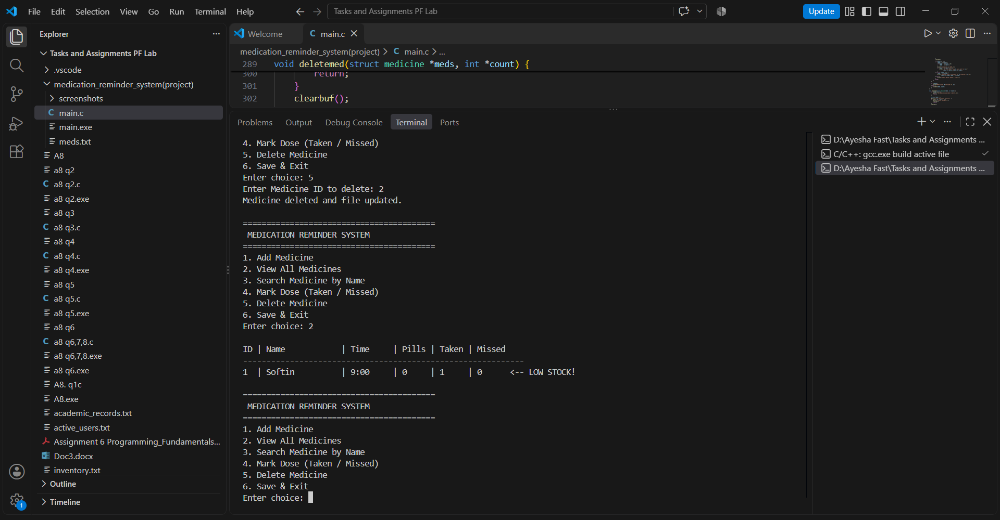
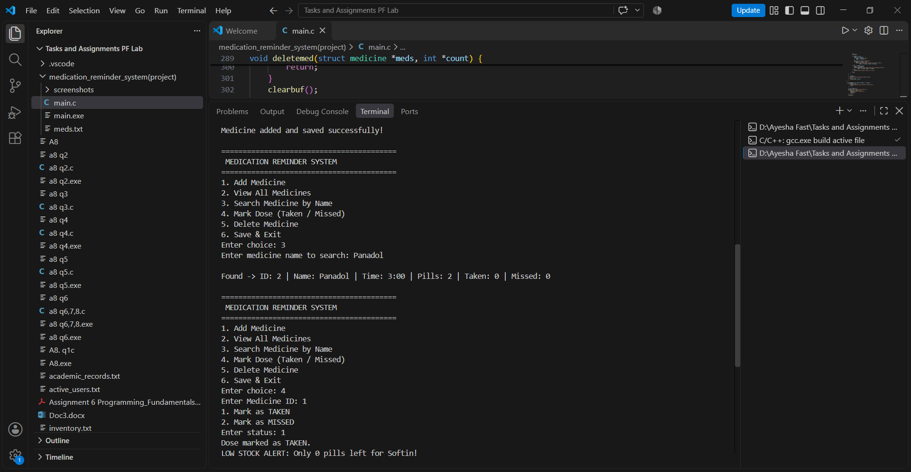
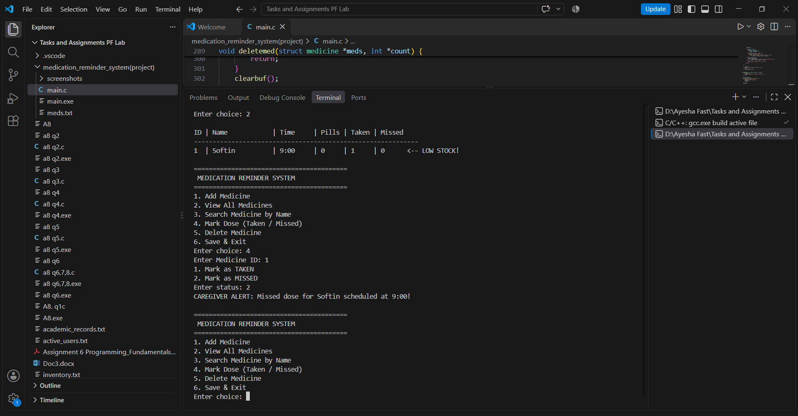
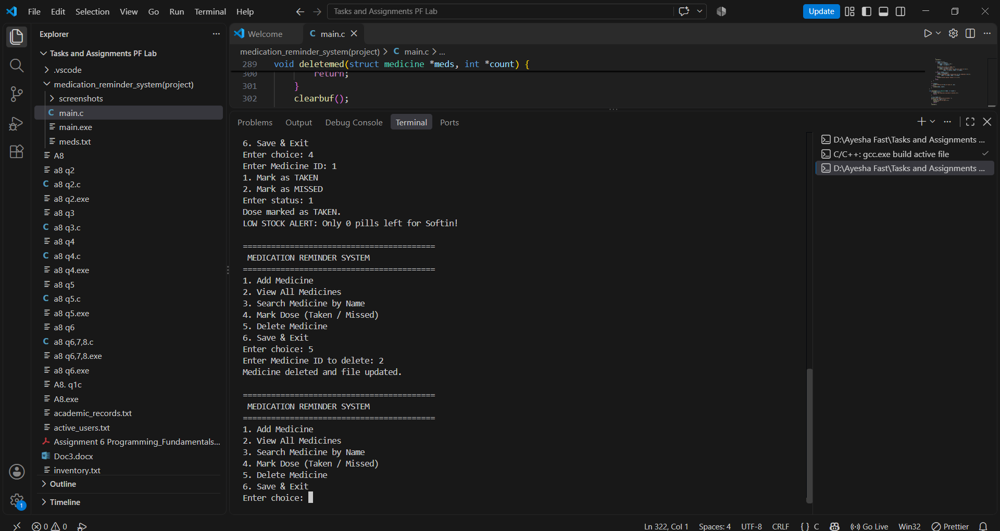
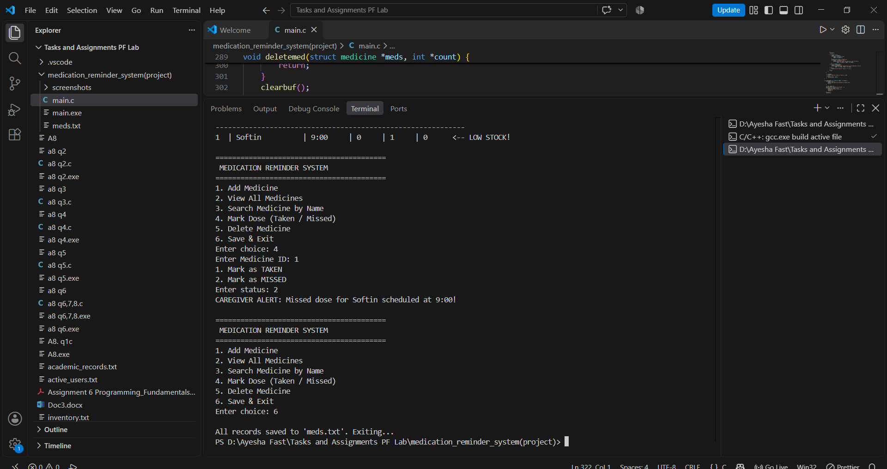
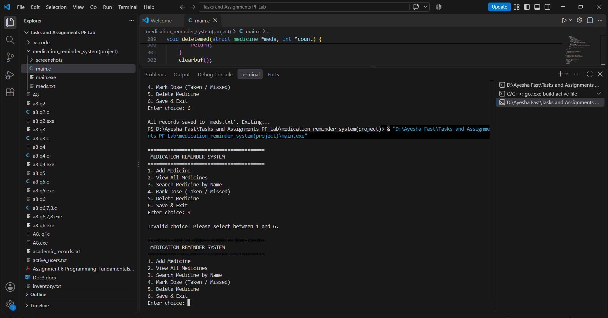

# Medication Reminder System for Elderly People with Caregiver Alerts

## Section A: Project Introduction
The Medication Reminder System is a console-based application developed in C to help elderly individuals take their medicines on time and alert caregivers when a dose is missed. Because elderly patients often forget doses or accidentally double-dose, this program securely tracks medicine names, scheduled times, remaining pill counts, and taken/missed history using file handling (`meds.txt`). Key features implemented in C include adding, viewing, searching, updating, and deleting medication records, automatic low-stock warnings (when pills are 5 or fewer), and immediate caregiver alerts for missed doses.

## Section B: Features & Test Cases (Execution Scenarios)

* **Case 1: Adding a New Medicine**
  * **Description:** Tests adding a new medication record into the system and saving it to `meds.txt`.
  * **Inputs:** Menu choice `1`, Medicine Name: `Panadol`, Time: `08:00AM`, Pills: `20`
  * **Expected Output:** Displays `Medicine Added Successfully!` and assigns a new ID with `0` taken and `0` missed doses.
  * **Screenshot:** 

* **Case 2: Viewing All Medicines & Low Stock Warning**
  * **Description:** Recursively displays all saved medications in a formatted table and triggers a warning if pills are 5 or less.
  * **Inputs:** Menu choice `2`
  * **Expected Output:** Lists all medicines with ID, Name, Time, Pills, Taken, and Missed counts, along with `LOW STOCK!` warning if pills are 5 or fewer.
  * **Screenshot:** 

* **Case 3: Searching a Medicine by Name**
  * **Description:** Recursively searches the stored records for a specific medicine name entered by the user.
  * **Inputs:** Menu choice `3`, Medicine Name: `Panadol`
  * **Expected Output:** Displays the matching medicine's complete record (ID, Name, Time, Pills, Taken, Missed).
  * **Screenshot:** 

* **Case 4: Marking a Dose (Taken / Missed & Caregiver Alert)**
  * **Description:** Tests marking a scheduled dose as Taken or Missed, updating pill/dose counts, and generating a caregiver alert when missed.
  * **Inputs:** Menu choice `4`, Medicine Name, Dose Status (`1` for Taken or `2` for Missed)
  * **Expected Output:** Updates taken/missed counts and displays `CAREGIVER ALERT` when a dose is marked as missed.
  * **Screenshot:** 

* **Case 5: Deleting a Medicine Record**
  * **Description:** Tests removing a medication record from the array, re-numbering remaining IDs, and updating `meds.txt`.
  * **Inputs:** Menu choice `5`, Medicine Name to delete
  * **Expected Output:** Removes the medicine from the list and shifts/re-numbers the remaining records.
  * **Screenshot:** 

* **Case 6: Saving Data & Exiting**
  * **Description:** Saves all current medication records permanently to `meds.txt` before closing the application.
  * **Inputs:** Menu choice `6`
  * **Expected Output:** Writes updated records to `meds.txt`, displays confirmation message, and exits cleanly.
  * **Screenshot:** 

* **Case 7: Invalid Input & Error Handling**
  * **Description:** Tests how the system handles invalid menu choices or unrecognized inputs.
  * **Inputs:** Out-of-range menu choice (e.g., `9`)
  * **Expected Output:** Displays an invalid choice error message and re-prompts the user with the main menu.
  * **Screenshot:** 

## Instructions to Clone and Execute

### Step 1: Clone the Repository
Open your terminal and execute:
```bash
git clone https://github.com/AyeshaGit-A/medication_reminder_system.git
cd medication_reminder_system
```

### Step 2: Compile the Code
Compile your C code using GCC:
```bash
gcc main.c -o medication_reminder
```

### Step 3: Run the Program
Windows (Command Prompt):
```cmd
medication_reminder.exe
```
